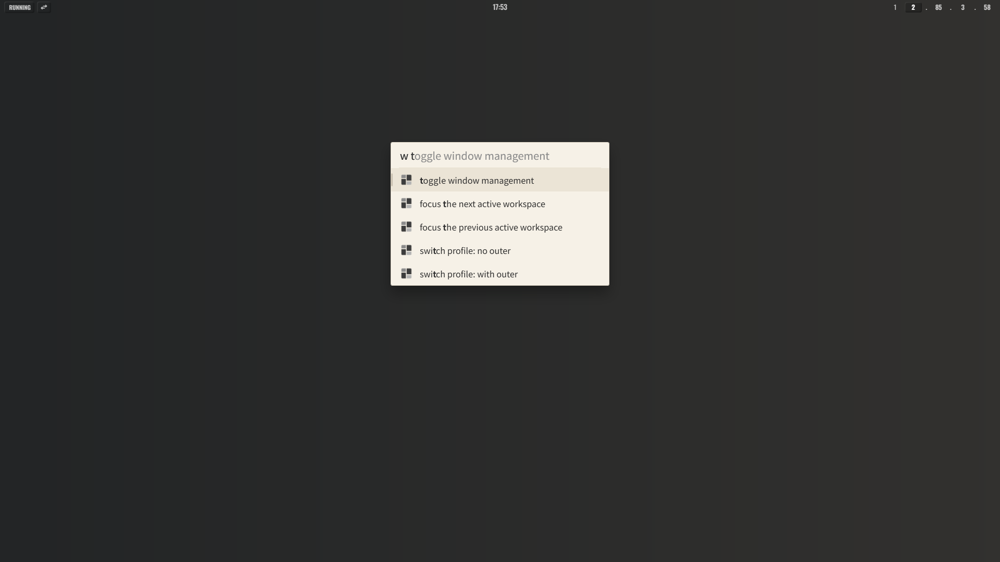
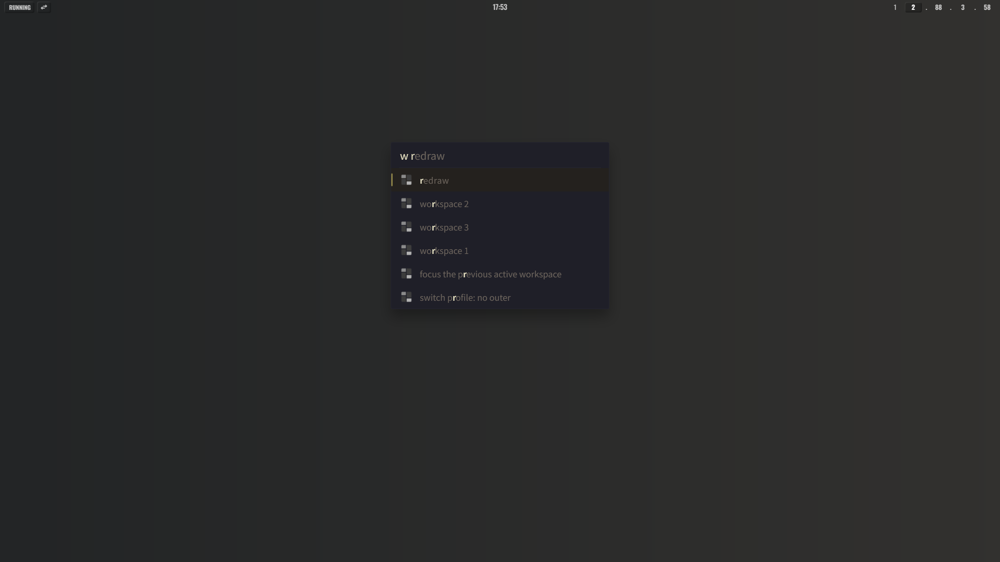

# Flow.Launcher.Plugin.GlazeWM

A [Flow Launcher](https://github.com/Flow-Launcher/Flow.Launcher) plugin for
controlling [GlazeWM](https://github.com/glzr-io/glazewm).

Quickly switch workspaces, move windows, toggle window management, and more from
Flow Launcher.

## Screenshots

|                    a.                    |                   b.                   |
| :--------------------------------------: | :------------------------------------: |
|  |  |

https://github.com/user-attachments/assets/8b9efae8-af42-4050-a4dc-20424ecf2c33

<sub>Using
[yuruyurau/Flow.Launcher.Theme.A](https://github.com/yuruyurau/Flow.Launcher.Theme.A)
for the preview.</sub>

## Usage

Type `w` followed by a command: `w <query>`

### Available Commands

- `toggle window management`
- `focus the next active workspace` / `focus the previous active workspace`
- `resize mode`
- `reload config` / `redraw`
- `workspace 1` ~ `workspace 9`
- `move → workspace 1` ~ `move → workspace 9`
- `switch profile: no outer` / `switch profile: with outer` (see Optional)

## Installation

```text
pm install https://github.com/yuruyurau/Flow.Launcher.Plugin.GlazeWM/releases/latest/download/GlazeWM.zip
```

**Or**

1. Download the latest release from
   [Releases](https://github.com/yuruyurau/Flow.Launcher.Plugin.GlazeWM/releases).
2. Extract the zip to `%APPDATA%/FlowLauncher/Plugins/GlazeWM/`.
3. Restart Flow Launcher.

## Optional: Switch Outer Gap Profiles

1. Copy the `profiles/` folder to `%USERPROFILE%/.glzr/glazewm/`.
2. Make sure [Nushell](https://github.com/nushell/nushell) (`nu`) is available
   in your PATH.
3. Use `w switch` in Flow Launcher to switch profiles.

   <details>
   <summary>switch_no_outer.nu</summary>

   ```nu
   let base = ($env.USERPROFILE | path join ".glzr/glazewm")
   let config = ($base | path join "config.yaml")

   open $config
   | merge deep {
       gaps: {
         outer_gap: {
           top: "24px"
           bottom: "14px"
           right: "16px"
           left: "16px"
         }
       }
     }
   | to yaml
   | save -f $config

   ^glazewm command wm-reload-config
   ```

   </details>

   <details>
   <summary>switch_with_outer.nu</summary>

   ```nu
   let base = ($env.USERPROFILE | path join ".glzr/glazewm")
   let config = ($base | path join "config.yaml")

   open $config
   | merge deep {
       gaps: {
         outer_gap: {
           top: "56px"
           bottom: "58px"
           left: "68px"
           right: "68px"
         }
       }
     }
   | to yaml
   | save -f $config

   ^glazewm command wm-reload-config
   ```

   </details>

## Credits

- [Flow Launcher](https://github.com/Flow-Launcher/Flow.Launcher)
- [GlazeWM](https://github.com/glzr-io/glazewm)
- Assisted by [Grok](https://grok.com)
